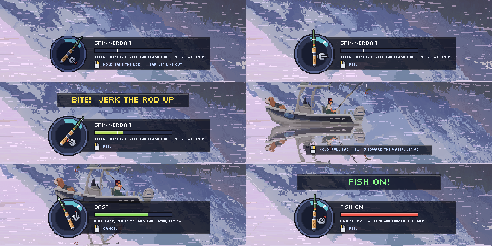

# Live Lure - a Cast n Chill mod

Hold the rod with your mouse: swing it to cast, work the lure the way that lure is really fished, and jerk the
rod to set the hook. Fish respond to how the lure moves, each kind in its own way, and the fight is yours to win
with an adjustable drag. Built for Cast n Chill 1.3.0 (Unity 6000.0.64f1, IL2CPP) on BepInEx 6 `be.788`.



**Just want to play it?** Download the zip from this repository's Releases page and follow
[player-readme.txt](player-readme.txt). You need your own copy of the game on Steam (Windows).

This is a fan-made mod, not made by or affiliated with the game's developers. Nothing from the game is in this
repository or in the download: no code, art, sound or data. The mod calls into your own copy of the game while it
runs.

## Playing

| Do this | To |
|---|---|
| **Hold right-click** | Take hold of the rod. The cursor stays put and the mouse moves the rod instead: up raises it, down lowers it. Let go and the rod settles back. |
| **Left-click while holding the rod** | Reel in. |
| **Tap right-click** | Open the bail so line runs out. Any click closes it. (Replaces the base game's hold-right-click.) |
| **Rod idle: hold right-click, pull back, swing toward the water, let go** | Cast. Power is mainly how far you drew the rod back (the bar shows it), scaled by how fast you swing: a slow swing uses a bit over half of it, a fast one all of it. Left-click during the wind-up cancels; letting go with nothing loaded cancels too. |
| **Jerk the rod up when you see BITE!** | Set the hook. Faster and harder is better; a weak or late jerk can miss, and a miss may spook the fish. If the rod is already held high, a sharp upward flick of the mouse still counts even though the rod has nowhere left to go. |
| **Watch the fish strip above the HUD** | It names the kind of fish following your lure and what will make it bite. See "Reading the fish" below. |
| **Mouse wheel** (or **X** / **Z**) | Turn the reel's drag knob whenever the rod is out: up (X) tightens, down (Z) loosens. The setting shows beside the meter and is remembered. |
| **Jerk the rod up with a fish on** | Pump it: each heave on a loaded line wears the fish down and can turn one that is running. See "The fight" below. |
| **F9 / F10** | Lower / raise mouse sensitivity for the rod and the cast. Saved automatically. |
| **F8** | Toggle the mod. |

The base game's own controls still work when you are not holding the rod (hold left-click to charge a cast,
hold left-click to reel). Idle/AFK mode is untouched and fishes the vanilla way.

The HUD is a rod handle on a dial with a plate beside it (see `hud-preview.png`):

- **The handle is your rod.** It swings exactly as the real rod does, sits dimmed until you take hold of it, pops
  and brightens when you grab, turns its reel crank as you reel, and winds back when you load a cast. The teal arc
  on the dial is the rod's range and the white tick is where it rests.
- **The meter** is the lure's action while fishing (fish are only attracted past the white tick, and a full meter
  attracts faster and from further away than vanilla), cast power while winding up, and line tension in a fight
  (there the white tick is where your drag starts to give line).
- **Under the meter**: how this lure wants to be worked, and what the mouse buttons do right now.
- With the rod idle only a one-line reminder shows, so the boat is not covered until you pick the rod up.
- If your lure is ever on the screen behind the HUD, the HUD slides sideways out of its way (`[Hud] StepAside`).

| Lure type | Known for | Also works (meter caps at 80%) |
|---|---|---|
| Float (bobber) | Leaving it still | |
| Crankbait, spinnerbait | Steady retrieve | Jigging |
| Swimbait | Slow, even retrieve | |
| Spoon | Lift, then let it flutter down | Plain retrieve |
| Jig head | Hop: lift, drop, pause | Plain retrieve |
| Blade bait | Sharp rips upward, let it fall | Plain retrieve |
| Wacky rig | Gentle lifts, sink on a slack line | Plain retrieve |
| Topwater | Pop it: a short twitch, a pause, another (see "Topwater" below) | Plain retrieve |
| Glide bait | Pull and pause | Plain retrieve |
| Drop shot | Small shakes without dragging it away | Jigging, plain retrieve |

The "also works" column comes from the game's own lure table.

### Reading the fish

Working the lure properly brings fish in. What happens when one arrives depends on what kind of fish it is. The
game's own fish table gives every species a temperament and a lifestyle; the mod turns those into five kinds of
fish, and a strip above the HUD plate tells you which kind is following and what it wants to see (see
`fish-hud-preview.png`). The strip is **green** while the lure is doing it, yellow while it is not, red when you
are doing the opposite.

| HUD calls it | Takes the lure when... | Who |
|---|---|---|
| **AMBUSHER** | it stops dead or drops right after it moved: pop it, then pause | northern pike, largemouth bass, walleye, lingcod, tiger muskie |
| **CHASER** | it speeds up and runs: sweep the rod, or start reeling again after a pause | smallmouth, striped and hybrid bass, rainbow, steelhead, brook and tiger trout, Atlantic and chinook salmon, pikeminnow, mountain whitefish |
| **STEADY FEEDER** | the lure's own action is kept going (action meter at half or more) | lake, brown and cutthroat trout, arctic char, dolly varden, coho, sockeye, pink, chum and masu salmon, white bass, sturgeon, shad, goldeye |
| **SHY FISH** | it lies still or sinks freely | perch, crappie, bluegill, grayling, the whitefish, cisco, shad and herring, chub, dace |
| **BOTTOM FEEDER** | same: stop and let it take | carp, catfish, suckers, redhorse, burbot, halibut, rockfish, rock bass |
| **WARY FISH** | you change the pace: a rip after gentle work, a stop after a long pull, a sudden speed-up | muskie |

- When the fish reaches the lure and the lure is doing what it wants, it **bites** (`BITE!`, or `LIGHT BITE!` from
  a shy or wary fish, which holds on for less time). If not, the base game's dice decide, and a miss is a bump:
  the strip says `BUMPED IT` and repeats what the fish wanted. It comes back a few seconds later. Do the opposite
  of what it wants twice and it turns away.
- **Reaction strikes.** Rip the lure (a hard yank; `[Fish] RipSpeed`) close to a predator and it may charge and hit
  on instinct, whatever lure you have on: the strip says `REACTION STRIKE`, then the prompt says `SMASH!`. You
  get less time to set the hook than on a normal bite. Pike and largemouth are the keenest (about 3 in 4 at point
  blank on a hard rip), then the other bass and pikeminnow, then trout and salmon; walleye and muskie now and
  then; shy fish and bottom feeders never. A fish that watched the lure go by will not fall for the next rip
  either: give it a few seconds.
- **Spooking.** The same rip sends shy fish, bottom feeders and (less often) trout the other way, and loses you a
  shy fish that was following. The exception is a lure whose proper action is hard strokes: it does not scare the
  fish the game says that lure is made for.
- **Splashdown.** A lure landing within a rod's length of fish gets noticed: shy ones scatter for a few seconds
  and a predator may come to look. Cast past them and bring the lure to them.
- **Being noticed.** How far off a fish notices a well-worked lure now also depends on the fish: a lively lure is
  noticed from further by aggressive fish and from less far by shy ones, a calm lure the other way round, and
  noisy lures (blade bait, crankbait, spinnerbait, topwater) carry further to fish with good hearing (shad,
  herring, catfish). This is a modest effect: from about 30% less far to 50% further.

All of it can be tuned or switched off in the `[Fish]` section of the config.

### The fight

In the base game a hooked fish tires on a clock: its fight lasts a set time (roughly 25 to 100 seconds by
species, double for a trophy) whatever you do. The reel has a drag, but a fixed one that only gives line while you are *not* reeling: hold
the reel, or hold the rod up, against a fish and the line sits at its limit until it snaps (four seconds there, in
total). With the mod the fight is yours (see `fight-hud-preview.png`):

- **Drag.** The mouse wheel sets it from 20% to 100% of what the line can take (default 50%), and the white tick on
  the tension meter shows where that is. Load above the setting pulls line off the reel, reeling or not: `DRAG 50%
  >>>` and the reel handle on the HUD runs backwards while it does. A loose drag cannot break the line but the fish
  takes line and tires slowly; a tight one wears it down fast and can part the line. Measured with the line loaded
  to 60% of its strength: at 20% drag the reel gave 15 to 25 px of line in a fifth of a second, hands off or
  reeling; locked it gave none; the base game, reeling, gave none and the tension went to 0.90.
- **Pressure tires the fish.** The harder the line is loaded the faster the orange bar beside `FISH ON` (the fight
  left in the fish) runs down: 0.7x the base game's rate on a slack line, 2.3x with the line at its limit.
- **Pump the rod.** The same sharp lift that sets a hook, on a loaded line, takes a bite out of the fish: 2.3 to
  2.9 seconds off a fish with 72 seconds of fight in the tests, so a dozen or so good pumps where the base game
  made you wait over a minute. A fish with a longer fight loses more seconds to each pump but a smaller share. Lower the rod and reel up the slack before the next; a pump within a second of the last
  counts for less, and one on a slack line for nothing (`WEAK PUMP`). The spool is held while you heave, so a pump
  loads the line harder than your drag setting alone would.
- **Turn it.** A pump against a fish that is running away from you can turn its head so it swims back toward you
  (`TURNED IT!`): up to about 1 in 2 for a fish that is light for the rod, far less for a heavy one.
- **Strain.** With the line at its limit the meter flashes and the strip says `LINE STRAIN`. Four seconds there in
  total parts it, as in the base game, and each heave on a line already at its limit adds 0.6 of a second.
- When the bar is empty the fish is `WORN OUT`: bring it in. Pumping it further does nothing, and the strip says so.
- **Landing.** As the fight goes out of the fish, and as it comes within about a rod's length, the drag firms up by
  itself (`[Fight] LandingGrip`). Close in, the game hauls a fish the last of the way with three times the pull,
  which ran straight through a light drag: in a logged fight a beaten fish took 17 seconds to bring to hand, most
  of it on a 20% drag. In the test it now comes in at reeling speed on that setting.

How much of this you feel depends on the fish against your tackle. A fish that is light for the rod barely loads
the line (a 10-weight fish on a 20-strength line pulled 0.1 to 0.3 of it while being reeled) and comes in on any
drag; near the top of what the rod can hold, the drag setting is the fight. Tuning is in `[Fight]`.

### Topwater

A topwater lure is fished as a popper (`[Topwater]` in the config; `pop-preview.png` shows three pops).

The base game gives this lure no water drag at all and ties it rigidly to the rod. With a rod you move by hand that
meant one twitch dragged it at 150 to 370 px/s (reeling is 50), up out of the water, and it kept gliding: in a logged
session the action meter never got above 0.15. Now:

- **Only part of the rod's movement reaches it** (40% by default, `PopTravel`), the way a slack line and a bending
  rod take up the rest. That is where the finesse comes from. Measured, each twitch made in 0.09 s:

  | Twitch of the rod | Rod tip travels | Lure travels | Top speed | Pop |
  |---|---|---|---|---|
  | 5 degrees | 4 px | under 1 px | 3 px/s | none: too small to break the surface |
  | 10 degrees | 8 px | 3 to 7 px | 14 px/s | a faint one |
  | 18 degrees | 15 px | 6 px | 30 px/s | small |
  | 30 degrees | 24 px | 11 px | 57 px/s | medium |
  | 55 degrees (most of the rod's range) | 43 px | 17 px | 75 px/s | a full chug, with bubbles |

- **The water stops it.** Half a second after any of those it was moving at 1 px/s or less (`PopBrake`).
- **It stays in the surface film** however steeply the line pulls, until it is within 45 px of the rod, where
  raising the rod lifts it out as before.
- **Each pop throws a splash and makes a sound**, both sized to the pop: a gentle one is drawn at 45% size and
  played at about a third of the volume and pitched up; a hard one is full size, full volume and lower. The splash
  is the game's own small-splash effect and the sound is the lure's own landing sound (`PopSplash`, `PopSound`,
  `PopVolume`, `PopSplashSize`).
- **The pop is what calls fish.** The action meter fills on pops with rests between them (anything from half a
  second to a couple of seconds apart; four or five fill it), and each pop is itself an attraction check rather
  than waiting for the usual timer. Dragging the lure along steadily still works as the lesser technique.
- Reeling brings it in along the surface at normal reeling speed.

Things the mod does to the line so a hand-held rod behaves:

- **A yank rips the lure.** The base game limits how fast the line can drag a lure to a speed chosen for reeling,
  and lets the reel's drag give line whenever tension spikes. Both are right for reeling and for a running fish,
  and both made a hard yank move the lure *less* than a slow lift. While you hold the rod with nothing hooked, the
  drag holds, loose line is snatched up as the yank starts, and the speed limit rises with how hard you are moving
  the rod (`[Rod] YankPower`). Measured: a hard yank went from moving the lure 22-30 px at 50 px/s to 42-56 px at
  155-185 px/s; a slow lift is unchanged.

- **The reel takes up slack the lure is not using**, so your next rod movement reaches the lure. Slack a sinking
  lure is still falling on is left alone.
- **Topwater lures float.** In the base game they hang at whatever depth they stop at. (See "Topwater" above for
  the rest of how they are handled.)
- **While you hold the rod the game does not reel by itself.** The base game reels at full speed whenever the lure
  leaves the water; with a movable rod that would snatch the lure in every time you lifted it clear.

Settings live in `BepInEx\config\mike.castnchill.livelure.cfg` (created on first launch). Most worth trying:
`[Rod] MouseSensitivity`, `[Rod] YankPower`, `[Cast] FullSwingSpeed`, `[Hookset] BestChance` / `Window` /
`ManualOnly`, `[Attraction] TemptChance` (a well-worked lure can tempt a fish that does not normally go for that
lure type; 0 restores the base game, where such fish nearly always turn away), `[Rod] GripButton`,
`[Rod] SlackPickup`, `[Rod] TopwaterFloats`.

## Building

This repository is meant to sit inside a game folder as `mod-src`: the scripts take the folder above them to be the
game. Install BepInEx into your copy of the game and start it once (see [player-readme.txt](player-readme.txt)), so
that `BepInEx\interop\` exists, then from the game folder:

```powershell
git clone <this repository> mod-src
.\mod-src\build.ps1 LiveLure      # compiles to BepInEx\plugins\LiveLure\
.\mod-src\run.ps1                 # launches the game, waits for BepInEx, prints plugin log lines, closes it
```

No .NET SDK is needed; `build.ps1` calls the Roslyn compiler that comes with Visual Studio Build Tools.

## Releasing

```powershell
.\mod-src\package.ps1             # writes release\LiveLure-<version>.zip in the game folder
```

That zip is the whole release: the plugin DLL, its symbols and the players' readme, laid out so it unzips straight
into a game folder. It is a `-Release` build, which keeps the machine's folder names out of the DLL and gives the
same file for the same source. Players install BepInEx themselves from its own site.

Nothing else from a game folder is ever shared or committed. In particular these are made from the game:

- `BepInEx\interop\` (generated from the game's code on first launch) and `BepInEx\unity-libs\`
- `BepInEx\probe\` and `mod-src\research\` (what the probe tool writes: disassembly of the game and dumps of its
  data tables). `research\` is in `.gitignore` for that reason.
- everything that came with the game (`castnchill_Data\`, `GameAssembly.dll`, `UnityPlayer.dll`, the exe)

and these are private: your saves and `BepInEx\config\` (your settings).

## How it hooks the game

| File | What it does | Game hook |
|---|---|---|
| `RodInput.cs` | Reads the grip button, left-click and mouse movement from Windows; pins the cursor while gripping; bail tap. | `GUICursor.UpdateButtons` prefix: the game's own click routing is skipped while the buttons are ours. |
| `RodPose.cs` | Rotates the real rod object. The game derives the tip, the line and the pull on the lure from that rotation, so nothing else is needed for the lure to feel it. | `Rod.LateUpdate` prefix adds the angle; it is taken off at the start of the next frame so the game's animator always sees its own value. |
| `Casting.cs` | Swing-to-cast: wind-up pose follows the mouse, release sets `Rod.CastPower` from draw-back and swing speed. | `Angler.RodAimingState.Update` prefix replaces the game's timed power ramp while a swing cast is in progress. |
| `LureController.cs` | Per-lure motion analysis, attraction pulses, bite window and hookset odds; slack pickup, honest bail, topwater buoyancy. | `Lure.FixedUpdate` postfix; `Lure.AttractFish` + `LureData.CanTargetSpawn` prefixes (the game's timed tick can only scare fish for a player-fished lure); `Fish.ChaseState.TryHooking` postfix (a strike becomes a bite). |
| `Techniques.cs` | The per-lure-type rules and thresholds. Speeds are judged relative to the lure's `retrieveMaxSpeed`, the cap the game puts on how fast the line can drag it. | |
| `FishSense.cs` | Species behaviour. `Species` derives each fish's kind, reaction and spook odds from its `FishData` (chase action = temperament, idle action = lifestyle, speed, vision, hearing). `Motion` reads the lure as a fish would (still, falling, burst, rip, change of pace). `FishSense` runs reaction strikes, spooking and splashdown by scanning `Location.spawns`, judges whether the lure suits a follower, and feeds the HUD strip. | `Fish.ChaseState.TryHooking` postfix (shared with the hookset: the strike result is rewritten from the fit); `LocationObjectSpawn.FindAttractedFish` prefix/postfix (scales the lure's `visualMultiplier` per species for the one call); a charging fish is sent with `Fish.AttractToLure` and given its strike speed from the start. |
| `Fight.cs` | The fight: adjustable drag, pressure and rod pumps wearing the fish down, turning a running fish, line strain. | `Rod.UpdateLineForce` prefix/postfix (shared with the drag hold above): with a fish on, the rod's `response.startDragRatio` becomes the player's drag for the one call and a held reel reads as 0.999, because the game only lets the reel slip below full power. The fish's fight is `Fish.HookedState.m_fightTimer` counting down from `m_fightDuration`; pressure and pumps take time off it directly. A turn is the game's own `HookedState.PickNextHeading` toward the rod, with the odds from its `strugglingTurnChanceCurve`. |
| `Popper.cs` | Topwater lures: softens the rod's pull by letting line out and taking it back as the rod rises and falls (worked out in the rod's parent space, which is mirrored when the angler faces the other way), brakes the lure, keeps it on the surface, detects each pop and shows and sounds it. | Runs from the per-tick lure hook. Splashes are private copies of the game's `FXSplash_S` effect with its `ParticleEffect` script removed, so they can be resized and replayed without the game's pool or its full-volume sound. Sounds are started through `AudioExtensions.CreateInstance` and then given a volume and pitch through `fmodstudio.dll` directly. |
| `Hud.cs` | The overlay: rod-handle dial, plate, meter, prompts. Uses the game's own font. Slides aside if the lure is behind it. | |
| `HudArt.cs` | The HUD's pixel art as letter grids, turned into sprites at startup. `preview-art.ps1` renders the same grids to a PNG so the art can be edited without launching the game. | |

`JigAnim.ShouldActivate` is also patched so the base game's canned click-jig does not fight the mouse while the
rod is gripped, and `Angler.RodFishingState.Update` gets a postfix that undoes the base game's out-of-water
auto-reel while the rod is in hand. `Lure.AddRodRetrieveForce` (raise the drag-speed limit for the length of the
call, by how hard the rod is being yanked) and `Rod.UpdateLineForce` (take back line the reel drag let out while
nothing is hooked) are what make a yank rip the lure.

## Developer tools

- `[Debug] Telemetry` logs lure motion once a second plus every stroke, pulse, bite, hookset roll and cast to
  `BepInEx\LogOutput.log`. Read this before changing thresholds.
- `[Debug] SelfTest = true` blocks saving and achievements, lets idle mode get a line in the water, then plays
  scripted input through the same path the real mouse uses and prints PASS/FAIL per step: grip and turn the rod,
  reel, bail tap, reel in, swing cast, a forced missed hookset and a forced landed one. It does not touch the real
  pointer. Run it with `.\mod-src\run.ps1 -WaitFor 'SELFTEST COMPLETE' -TimeoutSec 400`.
- `[Debug] SelfTestLure = <lure id>` (with SelfTest on) instead equips that lure, casts it and logs its position,
  line, slack and reel state five times a second through rest, twitches, reeling, a full raise and a bail tap.
  This is how the topwater problems were found; use it before guessing about any lure that "feels wrong". It also
  prints `LAB MOVE` lines: rod-tip travel versus lure travel and top speed for a gentle lift, a brisk jig, hard
  yanks and a twitch, and logs hard yanks frame by frame (`YANK` lines).
- `SelfTestLure = fish` checks the fish behaviour: it logs how the mod classifies all 68 species (`SPECIES` lines)
  and which live at the current spot (`HERE`), checks the bite rules against made-up lure movement (`RULE`), then
  plays each reaction out in the water: splashdown, a follower on the HUD, a bump, two refusals, a bite left
  unanswered, a rip with every fish in reach made to respond, and a reaction strike hooked. It also photographs
  the fish strip in each of its looks.
- `SelfTestLure = fight` checks the fight: the wheel moves the drag; then it hooks the heaviest fish in reach that
  the tackle can land, loads the line to a known stretch and measures what the reel gives at a loose drag, a locked
  one, while reeling, and with the line left to the base game (`SLIP` lines); pumps the rod on a loaded line and
  checks what each pump took, that a hurried one counts for less, the worn-out call, the landing, and that the
  rod's own drag figure is back as it was.
- `SelfTestLure = pop` checks the topwater handling: puts topwater01 on and casts it, shows the game's own splash
  beside the mod's at several positions and sizes (with the HUD off, and `AT <name> x,y` giving the lure's place
  in the window so the screenshots can be cropped to it), then makes twitches of 5 to 55 degrees and reports rod-tip
  travel against lure travel, top speed, whether it stopped and stayed in the water and how hard a pop each made;
  five pops a second apart for the action meter; and a short retrieve.
- Every script wakes the game from idle mode once it has the angler. Idle mode uses a different camera: under it a
  lure on the surface sits at the very bottom of the screen, behind the HUD.
- `SelfTestLure = hud` walks the overlay through each of its looks and logs `SHOT <name>` at each; `run.ps1`
  photographs the game window on those markers (it asks the window to draw itself, so it works even when the game
  is behind other windows) into `BepInEx\probe\shots\`.
- `Probe\` is a separate plugin, used to work out how the game behaves: it disassembles the methods listed in
  `BepInEx\probe\targets.txt` and dumps the data tables, on your own machine from your own copy. Build it with
  `.\mod-src\build.ps1 Probe -ExtraCoreRefs Iced`. What it writes is made from the game and stays out of the
  repository.

## Known limits

- The self-test feeds scripted input in above the Windows layer, so the actual button polling and cursor pinning
  are only exercised by a person playing.
- Technique thresholds were measured on the spoon and spinnerbait, and the topwater's physics were checked in
  the lure lab; other lure types use the same model with reasoned numbers.
- Mouse movement is read as cursor travel, so Windows pointer speed and acceleration affect it. F9/F10 are there
  to match it to your mouse.
- The fish behaviour is verified mechanically (every path runs and does what it should), but its odds and ranges
  are reasoned, not yet tuned against real play. `[Fish] ReactionChance`, `SpookChance`, `RipSpeed` and
  `ReactionRange` are the knobs; the log records every reaction, spook and strike with its chance and roll.
- A fish's kind comes from the game's own temperament and lifestyle data, so a few will not match what an angler
  expects of that species (the game calls muskie skittish and channel catfish steady, for instance).
- The fight is verified the same way: every part runs and measures as described, on scripted input. Reading the
  real mouse wheel goes through the game's input system and has not been exercised by the tests (X and Z are read
  the same way as F8 to F10, which are known to work). How fast fish should tire is a judgement, not a measurement.
- In this game a hooked fish only loads the line while it is being pulled, so with your hands off the reel and the
  rod still, the tension is near zero whatever the drag.
- The pop sound was chosen without being heard: the tests confirm a sound is started at the right moments with
  the right volume and pitch values, not how it sounds. `[Topwater] PopSound` switches between the lure's landing
  sound and the small and medium fish splashes, or turns it off.
- The game's splash effect draws 14.5 game pixels to the left of where it is put (its own lure-landing splash shows
  the same). The mod shifts its pops to compensate; the figure was measured from screenshots.
- Heaving the rod pulls the tip up and back. If the fish has got round behind you that slackens the line instead
  of loading it, and the pump counts for nothing.
- The angler's arms do not follow the rod: the rod pivots in the hands.
- With the mod on, a tap of right-click is the only way to let line out with the mouse (set `BailTap = false` and a
  different `GripButton` to get the base game's hold-right-click back).

## Licence

The mod's code is under the [MIT licence](LICENSE). That covers this repository only. Cast n Chill and everything in
it belong to its developers; BepInEx and the libraries it ships are separate projects under their own licences.
